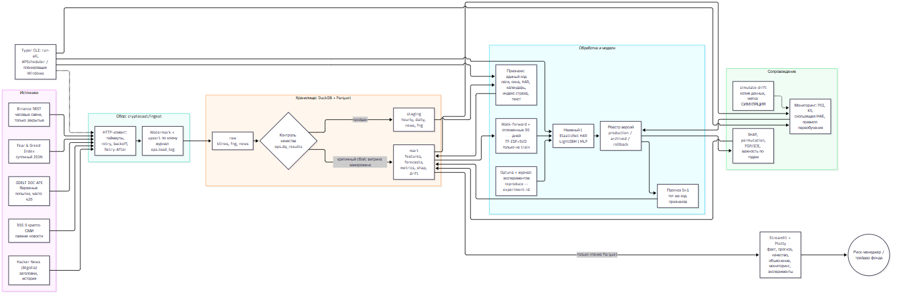

# cryptocast

Прототип прогнозно-аналитической системы по дисциплине «Проектный практикум», тема № 21 «Рынок цифровых активов».

Система каждые сутки прогнозирует на следующий день UTC для BTC, ETH, SOL, BNB, XRP к USDT:

- логарифм суммарного объёма торгов (quote volume);
- реализованную волатильность (корень из суммы квадратов часовых лог-доходностей).

Пользователь — риск-менеджер или трейдер небольшого фонда. Дашборд помогает оценить, какой объём можно исполнить завтра и нужно ли снижать риск. **Прогнозы не являются торговым советом.**

Автор: Запорожец Михаил Романович, группа БВТ2304.

## Архитектура



Исходник схемы: [docs/architecture.mmd](docs/architecture.mmd).

Поток данных: источники → инкрементальный сбор (watermark, upsert, журнал) → `raw` → контроль качества → `staging` → единый расчёт признаков → `mart` → walk-forward и отбор модели → реестр версий → прогноз D+1 → мониторинг → дашборд.

| Слой | Назначение | Где |
|---|---|---|
| raw | исходные записи, ключи для upsert | DuckDB `raw.*`, Parquet `data/lake/raw` |
| staging | очищенные часовые и суточные данные, новости | DuckDB `staging.*`, Parquet `data/lake/staging` |
| mart | признаки, прогнозы, метрики, объяснения, мониторинг | DuckDB `mart.*`/`ml.*`, Parquet `data/lake/mart` |
| ops | журнал загрузок, контроль качества, watermark, решения мониторинга | DuckDB `ops.*` |

Структура кода:

```
cryptocast/ingest/      сбор: HTTP-клиент, источники, журнал
cryptocast/quality.py   контроль качества
cryptocast/staging.py   единый вид данных, суточные агрегаты, чистка текста
cryptocast/features.py  единый код признаков для обучения и инференса
cryptocast/ml/          метрики, walk-forward, модели, эксперименты, реестр
cryptocast/interpret.py SHAP, permutation, PDP/ICE, сравнение периодов
cryptocast/monitoring.py PSI/KS, скользящая MAE, правило переобучения, симуляция
cryptocast/leakage.py   проверки отсутствия утечки
cryptocast/pipeline.py  оркестрация, run-all, снимок
cryptocast/dashboard/   Streamlit
tests/                  pytest
docs/                   источники, вопросы дашборда, чек-лист, защита
```

## Почему такой стек

- **Python 3.12** — единая среда для данных, моделей и интерфейса.
- **DuckDB + Parquet** — встраиваемая аналитическая СУБД без сервера: upsert по первичному ключу и транзакции. Дашборд читает только Parquet, поэтому не конфликтует с единственным пишущим процессом DuckDB.
- **scikit-learn, LightGBM, Optuna, SHAP** — три разных класса моделей, байесовский подбор с ограничением бюджета, точные объяснения деревьев.
- **Streamlit + Plotly** — интерактивный дашборд на Python без отдельного фронтенда.
- **Typer** — CLI, **pytest** — тесты, **config.yaml + .env** — конфигурация, **APScheduler** — расписание без внешних служб.
- Docker не нужен: зависимости зафиксированы в `requirements.txt`.

## Развёртывание с нуля (Windows)

Нужны Python 3.11+ и git.

```powershell
git clone https://github.com/Ra1naks/crypto-forecast-pp.git cryptocast
cd cryptocast
py -3.12 -m venv .venv
.venv\Scripts\python -m pip install --upgrade pip
.venv\Scripts\pip install -r requirements.txt
copy .env.example .env   # необязательно: все переменные имеют значения по умолчанию
```

Полный цикл одной командой (сбор, качество, витрина, модели, прогноз, мониторинг):

```powershell
.venv\Scripts\python -m cryptocast run-all
```

Первый запуск скачивает всю историю и обучает модели: на ноутбуке с 8 потоками он занял 47 минут, из них около 13 минут подбор гиперпараметров и 10 минут абляция. Повторный запуск догружает только новое и занял 2 минуты, из них около 70 секунд — бережные попытки GDELT.

Дашборд:

```powershell
.venv\Scripts\python -m cryptocast dashboard
```

Откройте http://localhost:8501.

Офлайн-демонстрация по снимку, без сети:

```powershell
.venv\Scripts\python -m cryptocast snapshot            # создаёт снимок из текущих данных
.venv\Scripts\python -m cryptocast dashboard --offline # показывает снимок
```

## Команды

| Команда | Что делает |
|---|---|
| `run-all [--offline] [--force-train] [--tune] [--no-analysis]` | полный цикл |
| `ingest --sources klines,fng,hn,rss,gdelt` | только сбор |
| `backfill-gdelt` | длительная догрузка истории GDELT |
| `quality`, `staging`, `features` | отдельные этапы подготовки |
| `tune` | Optuna с ограничением trials и timeout |
| `train [--analysis]` | сравнение моделей, регистрация, правило вывода |
| `analyze` | абляция по группам признаков, отбор, кодирование |
| `interpret` | важность, SHAP, PDP/ICE, сравнение периодов |
| `check-leakage` | усечение, метки времени, перемешанный таргет |
| `predict`, `monitor` | прогноз и мониторинг |
| `simulate-drift` | реакция системы на ухудшение на копии данных |
| `rollback <log_qv\|log_rv>` | возврат предыдущей версии модели |
| `reproduce --experiment-id <id>` | повтор эксперимента и сравнение метрик |
| `list-experiments` | журнал экспериментов |
| `snapshot`, `dashboard [--offline]`, `schedule` | снимок, интерфейс, расписание |

## Расписание

Ежедневный запуск без внешних служб: `python -m cryptocast schedule` (APScheduler, время в `config.yaml`).

Через планировщик Windows:

```powershell
schtasks /Create /TN cryptocast /SC DAILY /ST 03:20 /TR "powershell -NoProfile -Command cd 'C:\путь\к\проекту'; .venv\Scripts\python -m cryptocast run-all"
```

## Конфигурация

`config.yaml` содержит инструменты, источники, пороги качества, параметры валидации, бюджеты подбора, правила мониторинга и переобучения. Переменные окружения из `.env` (`CRYPTOCAST_DATA_DIR`, `CRYPTOCAST_ARTIFACTS_DIR` и другие) задают каталоги. Секретов проект не использует, все источники публичные.

## Тесты

```powershell
.venv\Scripts\python -m pytest -q
```

## Важные документы

- [docs/data_sources.md](docs/data_sources.md) — проверка источников и ограничения.
- [docs/dashboard_questions.md](docs/dashboard_questions.md) — вопросы пользователя к элементам дашборда.
- [docs/checklist.md](docs/checklist.md) — требования методички и доказательства.
- [docs/defense.md](docs/defense.md) — сценарий защиты.
- [docs/report.docx](docs/report.docx), [docs/presentation.pptx](docs/presentation.pptx) — отчёт и презентация.
